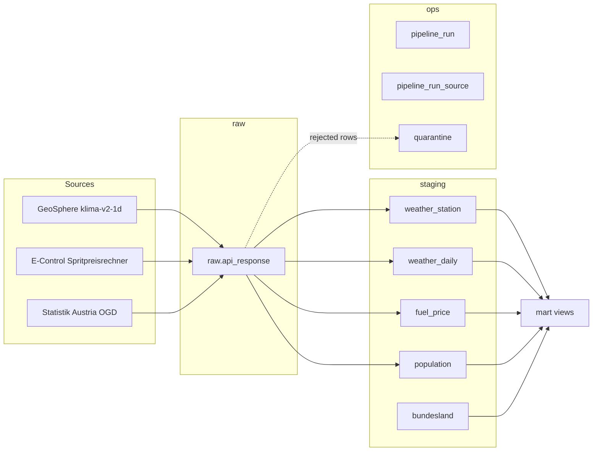

# Data dictionary

The warehouse has four schemas. Power BI reads only `mart`.

Shared conventions:

- All timestamps are `timestamptz` and stored in UTC.
- `raw_id` on a staging row points to the exact HTTP response it was parsed from (lineage).
- `loaded_at` is when the row was first written; `updated_at` is when its values last changed.

## raw

### raw.api_response

Every HTTP response, stored unchanged. Append-only.

| Column | Type | Null | Description |
|---|---|---|---|
| raw_id | bigint | no | Surrogate key (identity). |
| run_id | bigint | no | Run that fetched it. FK to `ops.pipeline_run`. |
| source | text | no | `geosphere`, `econtrol` or `statistik_austria`. |
| endpoint | text | no | Logical endpoint, for example `klima-v2-1d`, `station-metadata`, `fuel-by-region`. |
| source_url | text | no | Full request URL including the query string. |
| request_params | jsonb | no | Parameters used, for example station ids, date range, region, fuel type. |
| http_status | smallint | no | HTTP status code. |
| content_type | text | yes | Response `Content-Type` header. |
| body | text | no | Response body, byte for byte as received (decoded as UTF-8). |
| content_hash | char(64) | no | SHA-256 of the body, lowercase hex. |
| fetched_at | timestamptz | no | When the response was received. |

Index: `(source, endpoint, fetched_at DESC)` for "latest response per endpoint".

## staging

### staging.bundesland

The nine Austrian federal states. Seeded from `sql/schema/040_reference_data.sql`.

| Column | Type | Null | Description |
|---|---|---|---|
| bundesland_code | smallint | no | PK. Official code 1 to 9 (1 Burgenland ... 9 Wien). Same codes as E-Control and the first digit of Statistik Austria municipality codes. |
| name_de | text | no | German name, matches GeoSphere's `state` field. |
| name_en | text | no | English name, used in the dashboard. |
| iso_3166_2 | text | no | ISO code, `AT-1` to `AT-9`. Lets Power BI map visuals place regions. |

### staging.weather_station

GeoSphere stations, from the `klima-v2-1d` metadata endpoint.

| Column | Type | Null | Description |
|---|---|---|---|
| station_id | integer | no | PK. GeoSphere station id. |
| station_name | text | no | Station name, for example `Linz Stadt`. |
| bundesland_code | smallint | no | FK to `bundesland`, mapped from GeoSphere `state`. |
| latitude, longitude | numeric(8,5) | no | WGS84 coordinates. |
| altitude_m | numeric(6,1) | yes | Station altitude in metres. |
| valid_from, valid_to | date | yes | Period the station record is valid. |
| is_active | boolean | no | Station currently reporting. |
| updated_at | timestamptz | no | Last time metadata changed. |

### staging.weather_daily

One row per station and day. Grain: `(station_id, obs_date)`.

| Column | Type | Null | Source field | Description |
|---|---|---|---|---|
| station_id | integer | no | `station` | FK to `weather_station`. |
| obs_date | date | no | `time` | Observation day. |
| temp_mean_c | numeric(4,1) | yes | `tl_mittel` | Mean air temperature at 2 m, degrees C. GeoSphere computes it as (max + min) / 2. |
| temp_max_c | numeric(4,1) | yes | `tlmax` | Maximum air temperature at 2 m, degrees C. |
| temp_min_c | numeric(4,1) | yes | `tlmin` | Minimum air temperature at 2 m, degrees C. |
| precip_mm | numeric(5,1) | yes | `rr` | Precipitation, 24 h sum from 06:01 UTC to 06:00 UTC next day. Source uses `-1` for "no precipitation"; stored as `0.0`. Source `0` means "less than 0.1 mm", also `0.0`. |
| sunshine_h | numeric(3,1) | yes | `so_h` | Sunshine duration in hours. |
| min_quality_flag | smallint | yes | `*_flag` | Lowest quality code among this row's parameters (see below). |
| raw_id | bigint | no | | Lineage, FK to `raw.api_response`. |
| loaded_at, updated_at | timestamptz | no | | Load bookkeeping. |

GeoSphere quality codes (code list `q21`): `0` unchecked, `10` to `12` automatically checked, `20` to `22` manually checked. Values can be revised for up to 6 months, which is why the daily run re-fetches a trailing window.

Constraints: temperatures between -60 and 50, `temp_min_c <= temp_max_c`, precipitation 0 to 500, sunshine 0 to 24.

### staging.fuel_price

Daily snapshot of the cheapest stations per Bundesland and fuel type, as listed by E-Control. Grain: `(snapshot_date, bundesland_code, fuel_type, station_id)`.

| Column | Type | Null | Description |
|---|---|---|---|
| snapshot_date | date | no | Date of the fetch in Europe/Vienna time. |
| bundesland_code | smallint | no | FK to `bundesland`. Region queried. |
| fuel_type | text | no | `DIE` (diesel) or `SUP` (Super 95). |
| station_id | integer | no | E-Control station id. |
| station_name | text | no | Station name. |
| postal_code, city | text | yes | Station address parts. |
| latitude, longitude | numeric(8,5) | yes | Station coordinates. |
| price_eur | numeric(5,3) | no | Price per litre in EUR (3 decimals, as published). Constraint 0.5 to 5.0. |
| list_position | smallint | no | Position in E-Control's cheapest-first list (1 = cheapest). |
| fetched_at | timestamptz | no | Exact time of the snapshot. |
| raw_id | bigint | no | Lineage, FK to `raw.api_response`. |
| loaded_at | timestamptz | no | Load bookkeeping. |

Important: E-Control only returns the cheapest stations per region (about 5 to 15), not all stations. Metrics built on this table describe the **cheapest available price**, not an average market price. History exists only from the day the pipeline started; the API has no historical endpoint.

### staging.population

| Column | Type | Null | Description |
|---|---|---|---|
| bundesland_code | smallint | no | FK to `bundesland`. |
| reference_date | date | no | Always 1 January of the year (Statistik Austria "Bevölkerungsstand zu Jahresbeginn"). |
| population | integer | no | Residents, summed from municipality, sex and age rows. |
| raw_id | bigint | no | Lineage, FK to `raw.api_response`. |
| loaded_at | timestamptz | no | Load bookkeeping. |

PK: `(bundesland_code, reference_date)`.

## ops

### ops.pipeline_run

One row per execution of `python -m pipeline.run`.

| Column | Type | Null | Description |
|---|---|---|---|
| run_id | bigint | no | PK (identity). |
| started_at, finished_at | timestamptz | start no, end yes | `finished_at` stays NULL if the process crashed. |
| status | text | no | `running`, `success`, `partial` (some sources failed), `failed`. |
| mode | text | no | `daily` or `backfill`. |
| window_start, window_end | date | yes | Date range processed. |
| rows_read, rows_loaded, rows_rejected | integer | no | Totals across sources. |
| triggered_by | text | no | `local`, `schedule` or `workflow_dispatch`. |
| git_sha | text | yes | Commit the code ran from. Ties every row back to the exact code version. |
| error_message | text | yes | Short error for failed runs. |

### ops.pipeline_run_source

Per-source breakdown of a run. PK `(run_id, source)`. Same counters as `pipeline_run`, plus `status` (`success`, `failed`, `skipped`) and `error_message`.

### ops.quarantine

Records that failed validation.

| Column | Type | Null | Description |
|---|---|---|---|
| quarantine_id | bigint | no | PK (identity). |
| run_id | bigint | no | FK to `pipeline_run`. |
| raw_id | bigint | yes | FK to the response the record came from. |
| source | text | no | Source name. |
| target_table | text | no | Staging table the record was meant for. |
| record | jsonb | no | The record as parsed, before rejection. |
| reasons | text[] | no | One or more human-readable reasons. Must not be empty. |
| quarantined_at | timestamptz | no | When it was rejected. |

## mart

Views for Power BI, defined in `sql/views/` (Milestone 4).
